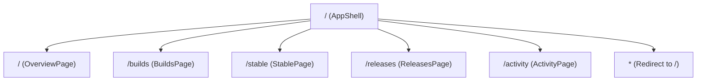

# Atlas — Build & Release Management Dashboard
# Authoritative Project State & Technical Inventory

**Report Version:** 1.1.0 (Milestone 1 — Runtime Foundation Restored)  
**Date:** October 12, 2026  
**Auditor / Engineer:** Senior Software Engineer (AI Systems Pair Programmer)  
**Verified Project Root:** `C:\Users\vravikumar\Desktop\Atlas\build\frontend\`  
**Repository Working Directory:** `C:\Users\vravikumar\Desktop\Atlas`  
**Git Branch / Status:** `main` (clean working tree; `build/` directory is untracked)  
**Runtime Operational Status:** **OPERATIONAL & RUNNABLE** (Build: PASS, Typecheck: PASS, Dev Server: PASS)

---

## Milestone 1 Change Log & Summary

### 1. Purpose of Milestone 1
The objective of Milestone 1 was to restore the runtime foundation of the Atlas Build & Release Management frontend, taking it from an unrunnable exported prototype to a fully verified, runnable web application without redesigning the UI or altering mock domain logic.

### 2. Runtime Problems Confirmed from Initial Audit
- **Confirmed Missing Application Entry Point:** `index.html` referenced `/src/main.tsx`, but no such file existed in `src/`. No DOM root mounting logic (`createRoot`) existed anywhere in the repository.
- **Confirmed Missing Vite Configuration:** No `vite.config.ts` existed to wire `@vitejs/plugin-react` and `@tailwindcss/vite`.
- **Confirmed Missing TypeScript Configuration:** No `tsconfig.json` existed; `npm run lint` (`tsc --noEmit`) could not run.
- **Confirmed Missing CSS Stylesheet:** No stylesheet existed to import Tailwind CSS v4 (`@import "tailwindcss";`), meaning all utility classes would render unstyled.
- **Confirmed Uninstalled Dependencies & PATH Quirk:** `node_modules` was absent. Running `npm install` directly initially failed on Windows because:
  1. Node was installed in `C:\Program Files\nodejs\` but not present in the session `PATH`, causing npm's child `cmd.exe` postinstall scripts to fail.
  2. Peer dependency conflicts between `esbuild@^0.25.0` (declared in devDependencies) and `esbuild@^0.27.0 || ^0.28.0` (required by `vite@8.3.4`), necessitating `--legacy-peer-deps`.

### 3. Files Added and Modified
| Action | File Path | Lines | Rationale |
|---|---|---|---|
| **CREATED** | `src/main.tsx` | 16 | Root DOM entry point importing `React`, `ReactDOM` from `'react-dom/client'`, `App`, and `./index.css`, mounting into `document.getElementById('root')!`. |
| **CREATED** | `src/index.css` | 18 | Tailwind CSS v4 entry point with `@import "tailwindcss";` and base styles preserving the lavender (`#F4F1FA`), white card, and Inter/JetBrains Mono design. |
| **CREATED** | `vite.config.ts` | 16 | Vite configuration defining `@vitejs/plugin-react` and `@tailwindcss/vite` plugins and development server bindings (port 3000, host 0.0.0.0). |
| **CREATED** | `tsconfig.json` | 27 | TypeScript compiler options configured with `"moduleResolution": "bundler"`, `"allowImportingTsExtensions": true`, `"noEmit": true`, and `"types": ["vite/client", "node"]`. |
| **CREATED** | `package-lock.json` | 4,613 | Generated by `npm install --legacy-peer-deps` locking 186 installed packages. |
| **REGENERATED**| `PROJECT_STATE.md` | ~900 | Updated authoritative baseline documentation per permanent protocol. |

*Note: Zero existing source components, routes, mock stores, or services were altered. The existing architecture remains completely intact.*

### 4. Verification Check Results
- **Dependency Installation (`npm install --legacy-peer-deps`):** **PASSED** (Exit Code: 0, 186 packages installed, 0 vulnerabilities).
- **TypeScript Validation (`npm run lint` / `tsc --noEmit`):** **PASSED** (Exit Code: 0, zero type errors).
- **Production Bundle Build (`npm run build` / `vite build`):** **PASSED** (Exit Code: 0, 1,717 modules transformed in 754ms, generating 44.94 kB CSS bundle and 441.40 kB JS bundle in `dist/`).
- **Development Server Startup (`npm run dev`):** **PASSED** (Started in 636ms on `http://localhost:3000`).
- **HTTP Endpoint Validation:** **PASSED** (`Invoke-WebRequest http://localhost:3000` returned HTTP 200 OK; dynamic compilation of `/src/main.tsx` and `/src/index.css` returned HTTP 200 OK).

---

## Permanent Documentation Protocol

This file, `PROJECT_STATE.md`, is established as the single authoritative source of truth for the Atlas Build & Release Management frontend repository.

### Mandatory Rules for Future Prompts:
1. **Read-First Rule:** Every subsequent prompt that modifies or audits this project must begin by reading `PROJECT_STATE.md` to preserve context and understand active constraints.
2. **Strict Scope Control:** Perform only the requested work specified in the user prompt without unsolicited refactorings.
3. **Verification Obligation:** Run relevant validation checks after any change and record the exact commands, exit codes, and output in the verification log.
4. **Single File Replacement Rule:** Maintain only one description file (`PROJECT_STATE.md`) located at the verified frontend root (`Atlas/build/frontend/PROJECT_STATE.md`). Never create timestamped, suffixed, or backup variants (such as `PROJECT_STATE_NEW.md`, `PROJECT_STATE_FINAL.md`, etc.). Replace this document with an updated, regenerated version reflecting the final filesystem state.
5. **No Code Loss:** Documentation regeneration must never delete or compromise application code, configuration, or unrelated assets.

---

## Table of Contents
- [A. Executive Summary](#a-executive-summary)
- [B. Repository Structure](#b-repository-structure)
- [C. Technology Stack](#c-technology-stack)
- [D. Application Routes and Screens](#d-application-routes-and-screens)
- [E. Component Inventory](#e-component-inventory)
- [F. Data and Domain Model](#f-data-and-domain-model)
- [G. Mock Data and Service Architecture](#g-mock-data-and-service-architecture)
- [H. User Interactions and Workflow Coverage](#h-user-interactions-and-workflow-coverage)
- [I. UI and Design Assessment](#i-ui-and-design-assessment)
- [J. Code Quality and Architecture](#j-code-quality-and-architecture)
- [K. Quantitative Statistics](#k-quantitative-statistics)
- [L. Risks and Prioritized Recommendations](#l-risks-and-prioritized-recommendations)
- [M. Verification Log](#m-verification-log)

---

## A. Executive Summary

### 1. What the Application Currently Is
Atlas — Build & Release Management Dashboard (internally titled *GitLab CI/CD Build & Release Hub*) is a single-page React 19 application built with Vite 8, TypeScript 7, Tailwind CSS v4, and React Router v7. It provides an enterprise console for managing the end-to-end software delivery lifecycle across multiple products.

### 2. Intended Purpose & Engineering Scope
$$\text{Product / Branch} \longrightarrow \text{Commit} \longrightarrow \text{Build} \longrightarrow \text{Pipeline Validation} \longrightarrow \text{Promote Stable} \longrightarrow \text{Release Build} \longrightarrow \text{Code Signing} \longrightarrow \text{Repackaging} \longrightarrow \text{Release Ready}$$

Core capabilities implemented:
- Multi-product switching (e.g., Enterprise Service Management `ESM`, Service Management Automation X `SMAX`).
- Branch and commit exploration with multi-status filtering and SHA links.
- Commit-to-build triggering.
- Automated multi-criteria gate evaluation for Stable baseline certification.
- Stable baseline promotion with automatic previous-baseline demotion.
- Release candidate build instantiation from certified Stable baselines.
- Multi-stage release progression visualization (Release Build $\rightarrow$ HSM Code Signing $\rightarrow$ Container Repackaging $\rightarrow$ Release Ready).
- Granular error explanation and retry handling for failed signing/packaging pipeline stages.
- Compliance audit log with dynamic CSV export.

### 3. Current Implementation Stage
- **Runtime Foundation:** **COMPLETE & OPERATIONAL** (Milestone 1 delivered).
- **Presentation Layer:** **COMPLETE (Mock UI)**. 5 full-featured screens, interactive modals, steppers, and cards.
- **In-Memory Mock Store:** **COMPLETE**. Stateful simulation of pipeline timers, asynchronous transitions, and audit records.
- **Service Layer Abstraction:** **COMPLETE**. Clean separation of data retrieval via `src/services/` with `VITE_USE_MOCK` branching.
- **Live Backend Integration:** **PLANNED FOR FUTURE PHASE**. Currently running in mock mode.

---

## B. Repository Structure

### 1. Workspace Layout
```
C:\Users\vravikumar\Desktop\Atlas/
├── .git/                                # Git VCS directory
├── gitlab-monitoring-dashboard/         # Sibling project: GitLab Pipeline Monitoring (FastAPI backend contract)
└── build/
    └── frontend/                        # Target project: Atlas Build & Release Management Dashboard
```

### 2. Verified Frontend Directory Tree (`build/frontend/`)
```
build/frontend/
├── .env.example                         # Environment configuration template
├── bun.lock                             # Bun package manager lockfile (82,497 bytes)
├── index.html                           # HTML5 entry document (loads /src/main.tsx)
├── metadata.json                        # AI Studio applet export metadata
├── package.json                         # Project package descriptor and npm scripts
├── package-lock.json                    # npm lockfile (186 packages installed)
├── PROJECT_STATE.md                     # Authoritative project state and baseline report
├── README.md                            # AI Studio export documentation
├── tsconfig.json                        # TypeScript configuration (bundler resolution, React JSX)
├── vite.config.ts                       # Vite configuration (React & Tailwind CSS v4 plugins)
└── src/
    ├── App.tsx                          # Re-export proxy: exports default from './app/App.tsx'
    ├── index.css                        # Global CSS stylesheet (@import "tailwindcss"; + base styles)
    ├── main.tsx                         # DOM mounting entry point (createRoot -> <App />)
    ├── app/
    │   ├── App.tsx                      # Root App component (DashboardProvider + RouterProvider)
    │   └── router.tsx                   # React Router v7 configuration (5 routes + wildcard)
    ├── components/
    │   ├── common/
    │   │   ├── CommitLink.tsx           # Monospaced GitLab commit SHA and pipeline links
    │   │   ├── EmptyState.tsx           # Reusable empty slate visual component (UNUSED)
    │   │   ├── ErrorBanner.tsx          # Error alert banner with retry trigger
    │   │   ├── index.ts                 # Barrel export
    │   │   ├── LastRefreshed.tsx        # Timestamp badge with spinning refresh trigger
    │   │   └── StatusBadge.tsx          # PipelineStatusBadge, StepStatusBadge, TagBadge
    │   ├── layout/
    │   │   ├── AppShell.tsx             # Master flex layout wrapper (Sidebar + Topbar + Outlet)
    │   │   ├── index.ts                 # Barrel export
    │   │   ├── Sidebar.tsx              # Collapsible navigation sidebar
    │   │   └── Topbar.tsx               # Header bar: product selector, search, role switcher, refresh
    │   └── ui/
    │       ├── Badge.tsx                # Variant-styled badge pill component
    │       ├── Button.tsx               # Reusable button with variants, sizes, loading spinner, tooltips
    │       ├── Card.tsx                 # Card, CardHeader, CardTitle, CardContent, CardFooter
    │       ├── Dialog.tsx               # Accessible modal overlay with backdrop, escape key, focus trapping
    │       ├── index.ts                 # Barrel export
    │       ├── Input.tsx                # Input field with left/right icon slots
    │       ├── Select.tsx               # Dropdown select with custom chevron indicator
    │       ├── Skeleton.tsx             # Animated pulse skeleton blocks and TableSkeletonRows
    │       ├── Table.tsx                # TablePagination and TableContainer (TableContainer UNUSED)
    │       └── Tabs.tsx                 # Tab navigation primitive (UNUSED)
    ├── config/
    │   ├── index.ts                     # Barrel export
    │   └── navigation.ts            # Route configuration array, icons, APP_CONFIG constants
    ├── features/
    │   ├── activity/
    │   │   ├── ActivityPage.tsx         # Full-page audit log with 5-parameter filter toolbar and CSV export
    │   │   └── ActivityTable.tsx        # Paginated tabular display of audit compliance entries
    │   ├── builds/
    │   │   ├── BranchSelectorPanel.tsx  # Left-rail branch selector card with update timestamps
    │   │   ├── BuildsPage.tsx           # Two-column layout managing branch commits, builds, modals
    │   │   ├── CommitTable.tsx          # Commit exploration table with action enablement guards
    │   │   ├── PromoteStableModal.tsx   # Multi-gate checklist verification dialog
    │   │   └── TriggerBuildModal.tsx    # Build trigger confirmation dialog
    │   ├── overview/
    │   │   ├── AttentionList.tsx        # Action-required failure list with deep links
    │   │   ├── OverviewPage.tsx         # Executive dashboard: KPI summary cards, running jobs, stable baselines
    │   │   ├── RecentActivityList.tsx   # Compact feed of recent actions
    │   │   ├── RunningList.tsx          # In-flight active runners and pipeline executions
    │   │   ├── StableBranchCard.tsx     # Branch card displaying certified stable version and promoter
    │   │   └── SummaryCard.tsx          # Vibrant gradient KPI metric cards
    │   ├── releases/
    │   │   ├── CreateReleaseModal.tsx   # Modal initiating release build from certified Stable build
    │   │   ├── ReleasesPage.tsx         # Release stage steppers, active pipeline cards, runs table
    │   │   ├── ReleasesTable.tsx        # Tabular release history with error resolution and retry button
    │   │   └── ReleaseStepper.tsx       # 4-stage horizontal pipeline progression visualizer
    │   └── stable/
    │       ├── StableCard.tsx           # Active baseline vs superseded previous baseline cards
    │       ├── StableHistoryTable.tsx   # Tabular promotion history with promotion timestamps
    │       └── StablePage.tsx           # Branch baseline cards, promotion launcher, candidate picker
    ├── hooks/
    │   ├── index.ts                     # Barrel export
    │   └── useDashboardContext.tsx      # Central React Context: product, role, search, refresh state
    ├── mocks/
    │   ├── mockData.ts                  # Seed fixtures: 2 products, 6 branches, 150 commits, 15 stable, 3 releases, 30 audit
    │   └── mockStore.ts                 # Stateful MockDataStore with async timers, stage progression, gate checks
    ├── services/
    │   ├── activity.ts                  # Audit log fetcher with filter serialization
    │   ├── apiClient.ts                 # Central REST client: USE_MOCK switch, API_BASE_URL, generic request()
    │   ├── builds.ts                    # Trigger build and pipeline status fetcher
    │   ├── commits.ts                   # Commit query service with multi-criteria filtering
    │   ├── index.ts                     # Barrel export
    │   ├── products.ts                  # Product catalogue and branch list retrieval
    │   ├── releases.ts                  # Create release, query releases, retry release stage
    │   └── stable.ts                    # Eligibility checklist evaluator, promote stable, stable history
    ├── styles/
    │   └── theme.ts                     # Color tokens, gradients, border radii (UNUSED by components)
    ├── types/
    │   └── index.ts                     # Complete TypeScript domain contracts and interfaces
    └── utils/
        ├── formatters.ts                # Date, time, relative time, and SHA shortening utilities
        └── index.ts                     # Barrel export
```

---

## C. Technology Stack

### Declared vs. Installed vs. Imported Dependencies
| Package | Version Declared | Version Installed | Imported in Code? | Usage Summary |
|---|---|---|---|---|
| `react` | `^19.0.1` | `19.3.0` | **YES** | React core library |
| `react-dom` | `^19.0.1` | `19.3.0` | **YES** | DOM root rendering in `src/main.tsx` |
| `react-router-dom` | `^7.18.4` | `7.18.4` | **YES** | Client routing in `router.tsx` and layout components |
| `lucide-react` | `^0.546.0` | `0.546.0` | **YES** | UI iconography across 19 components |
| `vite` | `^8.3.0` | `8.3.4` | Build tool | Dev server and production bundler |
| `@vitejs/plugin-react` | `^6.1.1` | `6.1.2` | Configured | Fast Refresh plugin in `vite.config.ts` |
| `@tailwindcss/vite` | `^4.3.3` | `4.3.3` | Configured | Tailwind CSS v4 bundler plugin in `vite.config.ts` |
| `tailwindcss` | `^4.3.3` | `4.3.3` | Installed | Utility class generator via `@import "tailwindcss";` |
| `typescript` | `^7.0.2` | `7.0.2` | Installed | Typechecking via `tsc --noEmit` and `tsconfig.json` |
| `@types/react` | `^19.3.0` | `19.3.0` | DevDep | React type declarations |
| `@types/react-dom` | `^19.3.0` | `19.3.0` | DevDep | React DOM type declarations |
| `@types/node` | `^22.14.0` | `22.20.5` | DevDep | Node ambient types |
| `@google/genai` | `^2.4.0` | `2.28.0` | **UNUSED** | Declared in package.json; zero imports in `src/` |
| `motion` | `^12.23.24` | `12.43.0` | **UNUSED** | Declared in package.json; zero imports in `src/` |
| `dotenv` | `^17.2.3` | `17.4.2` | **UNUSED** | Declared in package.json; zero imports in `src/` |
| `express` | `^4.21.2` | `4.22.3` | **UNUSED** | Declared in package.json; zero imports in `src/` |

---

## D. Application Routes and Screens



1. **Overview (`/`):** Summary KPI cards, Action Required failed stages, In-flight executions, Current Stable by branch, and recent activity feed.
2. **Builds (`/builds`):** Branch rail selector, commit history table, pipeline status badges, Trigger Build modal, and Promote Stable modal.
3. **Stable Builds (`/stable`):** Side-by-side Current vs. Previous Stable baseline comparisons, promotion history table, and candidate selector modal.
4. **Releases (`/releases`):** 4-stage release stepper, active release cards, runs table, and stage retry handlers.
5. **Activity (`/activity`):** Chronological compliance audit log with 5 filters and CSV export.

---

## E. Component Inventory
All components identified in the initial baseline remain in place, with the addition of:
- [`src/main.tsx`](file:///c:/Users/vravikumar/Desktop/Atlas/build/frontend/src/main.tsx): Core application DOM root mount.
- [`src/index.css`](file:///c:/Users/vravikumar/Desktop/Atlas/build/frontend/src/index.css): Core design stylesheet importing Tailwind CSS v4.

*(Refer to [Section E of Initial Baseline](file:///c:/Users/vravikumar/Desktop/Atlas/build/frontend/PROJECT_STATE.md#e-component-inventory) for full subcomponent classification).*

---

## F. Data and Domain Model
- Domain types in [`src/types/index.ts`](file:///c:/Users/vravikumar/Desktop/Atlas/build/frontend/src/types/index.ts):
  `Product`, `Branch`, `Commit`, `Build`, `Pipeline`, `StableRecord`, `ReleaseRecord`, `AuditEntry`, `EligibilityCheck`, `CommitFilterParams`, `ActivityFilterParams`, `PipelineStatus`, `SigningStatus`, `RepackagingStatus`, `Tag`, `UserRole`, `CheckStatus`.
- Domain models remain unchanged from the initial audit.

---

## G. Mock Data and Service Architecture
- **In-Memory Store:** Managed by [`src/mocks/mockStore.ts`](file:///c:/Users/vravikumar/Desktop/Atlas/build/frontend/src/mocks/mockStore.ts) using seed data in [`src/mocks/mockData.ts`](file:///c:/Users/vravikumar/Desktop/Atlas/build/frontend/src/mocks/mockData.ts).
- **Service Layer:** All components query via `src/services/` (`products.ts`, `commits.ts`, `builds.ts`, `stable.ts`, `releases.ts`, `activity.ts`). When `VITE_USE_MOCK=false`, requests delegate to `request<T>()` in `src/services/apiClient.ts`.

---

## H. User Interactions and Workflow Coverage
With the runtime foundation restored and dev server operational:
- **Build triggering:** Fully operational in mock store.
- **Stable eligibility evaluation:** Fully operational in mock store.
- **Stable promotion:** Fully operational in mock store.
- **Release creation and stage stepper:** Fully operational in mock store.
- **Failure retry handler:** Fully operational in mock store.
- **Audit filtering & CSV export:** Fully operational.
- **Remaining gap:** Topbar search bar is still disconnected from `BuildsPage.tsx` commit table filtering (scheduled for Milestone 2).

---

## I. UI and Design Assessment
- **Design System Preserved:**
  - Soft lavender background (`#F4F1FA`) and white card surfaces (`bg-white rounded-2xl border border-slate-100 shadow-[0_2px_12px_rgba(115,82,199,0.04)]`).
  - Brand accents: Purple gradients (`from-[#8E54E9] to-[#B66DFF]`) and status color pills.
  - Typography: Inter for UI typography and JetBrains Mono for commit SHAs, pipeline numbers, and release version tags.

---

## J. Code Quality and Architecture
- **Resolved in Milestone 1:**
  - `src/main.tsx` created and mounting cleanly.
  - `vite.config.ts` created and bundling correctly.
  - `tsconfig.json` created and validating cleanly with zero errors on `tsc --noEmit`.
  - `src/index.css` created and compiling Tailwind v4 utility classes.
- **Remaining Items for Future Milestones:**
  - Connect Topbar search input to `BuildsPage` commit filtering.
  - Remove dead dependencies from `package.json` (`@google/genai`, `motion`, `express`, `dotenv`).
  - Wire or deprecate unused `EmptyState.tsx`, `Tabs.tsx`, and `TableContainer`.
  - Add unit test suite (Vitest + happy-dom).

---

## K. Quantitative Statistics

### Updated File and Line Counts
| Extension | File Count | Physical Lines | Code Lines | Blank Lines | Comment Lines |
|---|---|---|---|---|---|
| `.tsx` | 42 | 4,700 | 4,355 | 321 | 24 |
| `.ts` | 21 | 1,930 | 1,686 | 163 | 81 |
| `.css` | 1 | 18 | 15 | 3 | 0 |
| **Subtotal (`src/` Source Files)** | **63** | **6,648** | **6,056** | **487** | **105** |
| `.json` (`package.json`, `metadata.json`, `tsconfig.json`, `package-lock.json`) | 4 | 4,698 | 4,698 | 0 | 0 |
| `.html` (`index.html`) | 1 | 20 | 20 | 0 | 0 |
| `.md` (`README.md`, `PROJECT_STATE.md`) | 2 | ~920 | ~850 | ~70 | 0 |
| `.example` (`.env.example`) | 1 | 9 | 4 | 2 | 3 |
| `.lock` (`bun.lock`) | 1 | 394 | 394 | 0 | 0 |
| **Total First-Party Project Files** | **72** | **~12,689** | **~12,022** | **~559** | **~108** |

*(Excludes `node_modules/` and `dist/`).*

---

## L. Risks and Prioritized Recommendations

### P0 — Critical Blockers
- **RESOLVED in Milestone 1:** `src/main.tsx`, `vite.config.ts`, `tsconfig.json`, `src/index.css`, and dependencies installed.

### P1 — Workflow & Integration Alignment (Next Milestone)
1. **Connect Global Topbar Search Input:** Bind Topbar search to `BuildsPage.tsx` filtering.
2. **Harmonize with GitLab Monitoring Dashboard:** Align pipeline status schemas and project identifiers between `build/frontend/` and `gitlab-monitoring-dashboard/`.

### P2 — Code Hygiene & Usability
1. **Remove Dead Dependencies:** Clean up `@google/genai`, `motion`, `dotenv`, `express` from `package.json`.
2. **Utilize `EmptyState.tsx`:** Replace ad-hoc empty divs in tables with the reusable component.
3. **Remove Dead Imports:** Clean up unused `CardHeader`/`Title`/`Content` imports.
4. **Dynamic Sidebar Mode:** Bind "Mock Mode" badge in `Sidebar.tsx` to `USE_MOCK`.

### P3 — Testing & Polish
1. **Automated Unit Testing:** Add Vitest test harness for gate logic and mock store transitions.
2. **Update Package Name:** Rename `"react-example"` in `package.json` to `"atlas-build-release-dashboard"`.

---

## M. Verification Log

| Command Executed | Purpose | Exit Code | Important Output / Findings |
|---|---|---|---|
| `$env:PATH = "C:\Program Files\nodejs;" + $env:PATH; & "C:\Program Files\nodejs\npm.cmd" install --legacy-peer-deps` | Install dependencies | `0` | Installed 186 packages in 17s. 0 vulnerabilities. |
| `$env:PATH = "C:\Program Files\nodejs;" + $env:PATH; & "C:\Program Files\nodejs\npm.cmd" run lint` | TypeScript typecheck | `0` | `tsc --noEmit` finished with zero errors. |
| `$env:PATH = "C:\Program Files\nodejs;" + $env:PATH; & "C:\Program Files\nodejs\npm.cmd" run build` | Production build | `0` | Vite v8.3.4 transformed 1,717 modules in 754ms; generated static assets in `dist/`. |
| `$env:PATH = "C:\Program Files\nodejs;" + $env:PATH; & "C:\Program Files\nodejs\npm.cmd" run dev` | Dev server test | `0` | Vite started ready in 636ms on `http://localhost:3000/`. |
| `Invoke-WebRequest -Uri "http://localhost:3000" -UseBasicParsing` | HTTP root verification | `0` | HTTP 200 OK returned. |
| `Invoke-WebRequest -Uri "http://localhost:3000/src/main.tsx" -UseBasicParsing` | Dynamic JS compilation | `0` | HTTP 200 OK returned compiled React JSX module. |
| `Invoke-WebRequest -Uri "http://localhost:3000/src/index.css" -UseBasicParsing` | Dynamic CSS compilation | `0` | HTTP 200 OK returned compiled Tailwind v4 stylesheet. |

---
*Report certified and updated on October 12, 2026 for Milestone 1 completion.*
